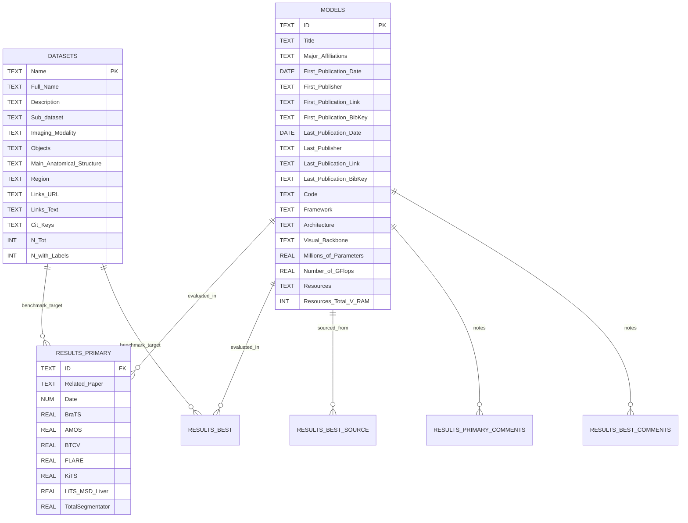
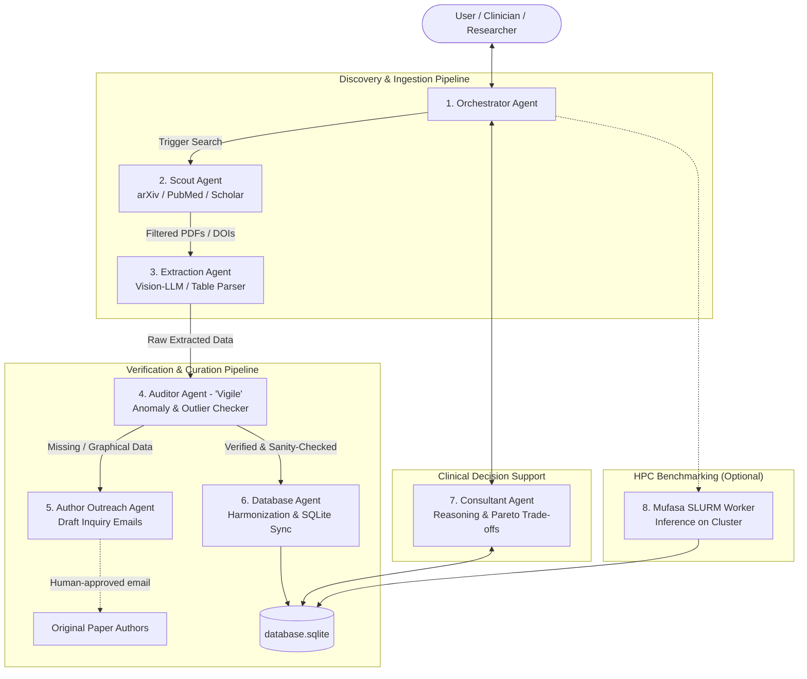

# PROJECT_CONTEXT: AgentForGMMIS
## Multi-Agent AI System for Generalist vs. Specialist Medical Image Segmentation Benchmarking

---

## 1. Executive Summary & Thesis Metadata

* **Thesis Title**: AI Agent to Compare Models for Medical Image Segmentation (AgentForGMMIS)
* **Author**: Luca Pezzoli (`luca2.pezzoli@mail.polimi.it`)
* **Academic Institution**: Politecnico di Milano — Department of Electronics, Information and Bioengineering (DEIB)
* **Degree Program**: Master of Science in Computer Science and Engineering / Biomedical Engineering
* **Advisor / Contact Person**: Andrea Moglia (`andrea.moglia@polimi.it`) — Hal9000 Lab & B3Lab @ PoliMi
* **Affiliated Research**: Hal9000 Lab & B3Lab (DEIB, Politecnico di Milano) and Università di Pavia
* **Language Requirement**: **All code, documentation, schemas, comments, and project artifacts MUST strictly be in English.**

---

## 2. Foundational Research Baseline

This thesis directly builds upon and operationalizes the benchmark research published in *Information Fusion*:

> **Reference Publication**:
> Andrea Moglia, Matteo Leccardi, Matteo Cavicchioli, Alice Maccarini, Marco Marcon, Luca Mainardi, Pietro Cerveri.
> *"Generalist models in medical image segmentation: A survey and performance comparison with task-specific approaches."*
> **Information Fusion**, Volume 127, 2026, Article 103709 (Online September 2025).
> DOI: [10.1016/j.inffus.2025.103709](https://doi.org/10.1016/j.inffus.2025.103709)
> arXiv Preprint: [arXiv:2506.10825](https://doi.org/10.48550/arXiv.2506.10825)
> Interactive Web Platform: [https://hal9000-lab.github.io/GMMIS-Survey/](https://hal9000-lab.github.io/GMMIS-Survey/)
> Repository: [https://github.com/Hal9000-lab/GMMIS-survey](https://github.com/Hal9000-lab/GMMIS-survey)

### Context & Motivation
In medical image segmentation, task-specific (specialist) models (e.g., nnU-Net, Swin UNETR) have historically dominated benchmarks on individual organs or datasets. The introduction of foundation architectures—spearheaded by the Segment Anything Model (SAM) and SAM 2—has triggered an explosion of **generalist medical image segmentation models**. However, clinicians, biomedical engineers, and researchers face high friction in determining:
1. When a generalist model outperforms an optimized task-specific model for a specific target organ or modality.
2. What computational budget (parameters, GFLOPs, VRAM) is required.
3. Which evaluation metrics represent genuine clinical generalizability versus dataset overfitting.

The advisor's work manually surveyed **98 generalist models**, **58 benchmark datasets**, and hundreds of evaluations. **The core goal of this Master's Thesis is to transition this static survey into an autonomous, self-updating Multi-Agent AI system.**

---

## 3. The Core Objective: Towards Agentic AI

As highlighted in Section 7.4 of the reference paper (*"Towards agentic AI, and physical AI"*):
> *"Agentic AI represents the subsequent stage of AI, beyond generative AI, where systems can decompose complex tasks into subtasks, store and retrieve information over a long time, take action, and interact with external tools."*

The objective of **AgentForGMMIS** is to design, implement, and validate a multi-agent system that:
1. **Automates Literature Discovery**: Systematically scans preprint servers (arXiv, bioRxiv/medRxiv) and peer-reviewed venues (MICCAI, CVPR, NeurIPS, IEEE TMI, MedIA, etc.) for emerging segmentation models.
2. **Standardizes Extraction & Harmonization**: Parses manuscripts to extract model metadata, architectures, hardware requirements, datasets evaluated, and Dice similarity coefficients (DSC), distinguishing between *primary research* and subsequent *best-in-literature* benchmarks.
3. **Curates & Updates the Knowledge Base**: Validates and ingests new entries into the structured SQLite database (`database.sqlite`) while preserving auditability and provenance.
4. **Delivers Intelligent Decision Support**: Serves as an interactive, reasoning-capable agent that assists medical doctors, researchers, and computer scientists in querying, comparing, and selecting the optimal segmentation model for target anatomies under specified hardware/latency constraints.
5. **Enables Automated Validation & Benchmarking (HPC Worker)**: Interfaces with the DEIB Mufasa GPU cluster to download code/weights, configure execution environments, and run automated standardized inference on benchmark datasets.

---

## 4. Survey Methodology to Automate

To ensure scientific validity, the multi-agent system must adhere to the exact criteria established in Moglia et al.:

### 4.1. Inclusion & Exclusion Criteria
* **Inclusion Criteria**:
  * English language papers with an abstract.
  * Published in peer-reviewed journals, top-tier conferences (CVPR, ICML, NeurIPS, MICCAI, etc.), or arXiv preprints.
  * Models targeting **3D radiological volumes** (Computed Tomography [CT], Magnetic Resonance Imaging [MRI], Positron Emission Tomography [PET]).
  * Generalist models tested on **publicly available datasets** to ensure reproducible comparisons.
  * Evaluation results reporting at least the **Dice Similarity Coefficient (DSC)**.
* **Exclusion Criteria**:
  * Models tested solely on private or proprietary datasets.
  * Exclusively 2D imaging modalities (e.g., fundus/retinal imaging, dermoscopy, standard endoscopy).
  * Studies omitting quantitative DSC scores.

### 4.2. Primary vs. Best-in-Literature Harmonization
* **Primary Work**: The initial publication introducing the model (its baseline performance and design).
* **Best-in-Literature**: The highest metric score achieved by that model across subsequent studies (accounting for retraining, improved prompting, architectural tuning, or independent re-evaluations, e.g. nnU-Net and MedSAM).
* **Performance Gain**: Monitored as $\Delta\% = \frac{\text{Dice}_{\text{best}} - \text{Dice}_{\text{primary}}}{\text{Dice}_{\text{primary}}} \times 100$.

### 4.3. Anatomical Categorization
Models and datasets are grouped across standard anatomical regions:
* **Head & Brain** (e.g., BraTS, ATLAS, FeTA, OASIS, WMH)
* **Head & Neck** (e.g., HNASC, ToothFairy)
* **Thorax & Cardiac** (e.g., ACDC, ASOCA, SegTHOR, MM-WHS)
* **Abdomen** (e.g., AMOS, BTCV, FLARE, KiTS, LiTS, WORD, CHAOS, 3D-IRCADb)
* **Pelvis & Prostate** (e.g., PROMISE12, Prostate158)
* **Spine & Musculoskeletal** (e.g., CTSpine1K, VerSe, SPIDER)
* **Whole Body** (e.g., AutoPET, TotalSegmentator)

---

## 5. Architectural Taxonomy of Generalist Models

The system classifies models based on the unified feature fusion taxonomy introduced in the paper:
* **Fusion Levels**:
  * **Level F0**: Early/Input fusion (combining raw modalities/prompts prior to encoding).
  * **Level F1**: Intermediate/Encoder-level fusion.
  * **Level F2**: Bottleneck/Latent space feature fusion.
  * **Level F3**: Decoder-level fusion.
  * **Level F4**: Late fusion / Output decision level.
* **Modalities & Prompting**:
  * **Image-Only Models**: Self-supervised or multi-dataset vision backbones (e.g., SuPreM, VoCo, Swin UNETR baselines).
  * **Vision-Language / Multimodal Models**: Models conditioning segmentation on textual prompts (e.g., BiomedParse, CLIP-Driven Universal Model).
  * **Promptable SAM / SAM 2 Adaptations**:
    * Zero-shot evaluation.
    * Parameter-Efficient Fine-Tuning (PEFT) / Adapters (e.g., Med-SA, SPA, Tri-Plane Mamba).
    * Full 3D volumetric adaptations (e.g., 3D-MedSAM, MedSAM-2).

---

## 6. Database Schema Reference (`database.sqlite`)

The current survey knowledge is stored in SQLite format (`../sources/database.sqlite`), structured as follows:



### Table Overview:
1. `models`: 98 models, capturing architectural families, backbones, parameter counts, GFLOPs, code repositories, and GPU hardware requirements.
2. `datasets`: 58 benchmark datasets, logging modalities (3D CT, MRI, PET), regions, sample sizes ($N_{\text{tot}}$, $N_{\text{labeled}}$), and URLs.
3. `results_primary`: Primary DSC scores across all 58 datasets for each model.
4. `results_best`: SOTA / best-in-literature DSC scores.
5. `results_best_source`: Citation keys or links identifying where the best score was published.
6. `results_primary_comments` & `results_best_comments`: Nuances regarding test splits, prompt settings (box vs. point vs. text), or evaluation differences.

---

## 7. Multi-Agent System Architecture (Target System)

The architecture follows a hierarchical supervisor-worker pattern incorporating specialized agents, dedicated verification ("Auditor / Vigile"), and automated human-in-the-loop author outreach:



### Agent Roles & Detailed Responsibilities:

1. **Orchestrator Agent (`OrchestratorAgent`)**:
   - Manages the overall workflow, execution state, and inter-agent communication.
   - Dispatches tasks to workers based on system events or user prompts.

2. **Literature Scout Agent (`ScoutAgent`)**:
   - Regularly queries scientific repository APIs (arXiv, PubMed, Semantic Scholar, OpenAlex).
   - Enforces inclusion/exclusion criteria (3D CT/MRI/PET, public datasets, Dice score present).
   - Downloads candidate PDFs and hands off to the Extraction Agent.

3. **Information Extraction Agent (`ExtractionAgent`)**:
   - Parses document structure, text, and numerical tables (using multimodal/vision LLMs).
   - Extracts model metadata (architecture, parameters, GFLOPs, backbone, code URL) and evaluation tables (per-organ/per-dataset Dice scores).

4. **Auditor Agent / "Il Vigile" (`AuditorAgent`)**:
   - **Quality Assurance & Anomaly Detection**:
     - *Outlier Detection*: Compares extracted Dice scores against historical baselines in `database.sqlite` (e.g., flags an impossible 0.99 Dice score on pancreas or sudden unverified 30% jumps).
     - *Sanity Checks*: Verifies that metrics match the right organ/dataset column, checks standard deviation vs. mean, and confirms whether test splits were standard or zero-shot.
     - *Self-Critique*: Triggers re-reading of specific PDF paragraphs/tables if confidence is low or values deviate abnormally.

5. **Author Outreach Agent (`OutreachAgent`)**:
   - Directly operationalizes the manual methodology of Moglia et al. (*"In case of missing information or graphical-only results, the corresponding author was contacted"*).
   - When the Auditor identifies that crucial Dice scores are reported only in bar/box charts or omitted:
     - Extracts the corresponding author's email and affiliation from the manuscript.
     - Automatically drafts a polite, standardized, and precise academic inquiry email requesting the numerical tables.
     - Submits the draft for human researcher approval before sending.

6. **Database Curation Agent (`DatabaseAgent`)**:
   - Performs entity resolution (standardizing dataset aliases like "BraTS 2021" $\rightarrow$ "BraTS").
   - Categorizes scores into Primary vs. Best-in-Literature, computes improvement gains ($\Delta\%$), and safely executes ACID transactions on `database.sqlite`.

7. **Decision Support & Consultant Agent (`ConsultantAgent`)**:
   - Interactive reasoning agent for end-users (doctors, bioengineers, computer scientists).
   - Solves multi-criteria trade-off queries (e.g., maximum Dice for Liver CT subject to $\le 16\text{ GB}$ VRAM).
   - Computes Pareto frontiers and statistical significance tests (Mann-Whitney U tests).

---

## 8. Computing Environment & Cluster Setup

### Local Development (Mac)
* **Workspace**: `/Users/pezzoli/PoliMi/Thesis/AgentForGMMIS`
* **Role**: Agent orchestration, API communication, local unit testing, database management.

### Remote HPC Cluster ("Mufasa" @ DEIB Polimi)
* **Access**: SSH via DEIB Polimi VPN (`gp-deib-saml.vpn.polimi.it`):
  ```bash
  ssh lpezzoli@10.79.23.96
  ```
* **Environment**:
  * Node: Multi-GPU compute cluster managed via SLURM.
  * Python: 3.12 (virtualenv at `~/AgentForGMMIS/venv`).
  * PyTorch: 2.6.0+cu124 (CUDA 12.4 supported by host 580.95 drivers).
* **Job Execution Policy**:
  * Batch Jobs: `sbatch run_job.sh` (SLURM QoS: `gpu`, GPU allocation: `3g.20gb:1`, 4 CPUs, 32GB RAM).
  * Interactive Debugging:
    ```bash
    srun --qos=gpu --gres=gpu:3g.20gb:1 --cpus-per-task=4 --mem=32G --pty /bin/bash
    ```

---

## 9. Phased Project Roadmap

1. **Phase 1 — Groundwork & Data Sync**:
   - Integrate existing `database.sqlite` into the repository.
   - Build a clean Python ORM / data access layer (e.g., SQLAlchemy or Pydantic models) around the survey schema.
2. **Phase 2 — Extraction & Harmonization Engine**:
   - Build document parsing pipelines (PDF text/table extraction with vision-language models).
   - Implement structured output validation for model architectures, datasets, and Dice scores.
3. **Phase 3 — Autonomous Scout & Continuous Ingestion**:
   - Implement the arXiv / PubMed monitor with automated inclusion/exclusion filtering.
   - Human-in-the-loop verification dashboard or CLI.
4. **Phase 4 — Comparison & Decision Support Agent**:
   - Build the conversational reasoning agent capable of answering complex medical segmentation trade-off questions.
   - Integrate statistical testing and visualization generation.
5. **Phase 5 — HPC Benchmarking Agent (Optional / Advanced)**:
   - Automated evaluation scripts on Mufasa for top generalist models on public datasets.

---

## 10. Directives for AI Agents (Antigravity / Gemini / LLMs)

When working in this repository:
1. **Always read this file first** to understand context, naming conventions, and scientific constraints.
2. **Strictly English**: Do not output Italian in code, commit messages, comments, or documentation files.
3. **Preserve Scientific Grounding**: Always distinguish between **Generalist** and **Task-Specific** models, and between **Primary** and **Best-in-Literature** scores.
4. **Respect Cluster Policies**: Never run heavy model inference or training directly on the local machine or Mufasa login node; always wrap GPU executions in SLURM batch/interactive templates.
