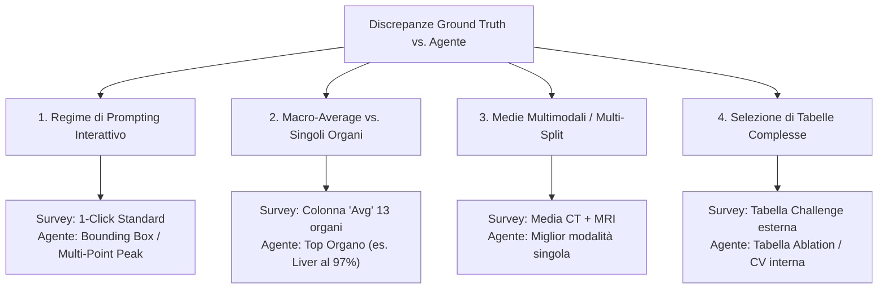

# Analisi della Discrepanza Epistemica: Ground Truth Survey (Moglia et al., 2026) vs. Estrazione Autonoma Peak Performance (AgentForGMMIS)

> **Documento di Sintesi per la Riunione di Tesi**  
> **Autore**: Luca Pezzoli  
> **Oggetto**: Analisi metodologica delle discrepanze tra i punteggi Dice estratti dagli agenti LLM e i valori curati manualmente nel database della survey di riferimento.

---

## 1. Executive Summary & Razionale Metodologico

Nello sviluppo del sistema autonomo di estrazione e auditing per benchmark di segmentazione medica (**AgentForGMMIS**), il confronto quantitativo (calcolo del Dice MAE) contro il database di Ground Truth curato da umani (`data/database.sqlite`, basato sulla survey *Moglia et al., Information Fusion 2026*) rivela un fenomeno di fondamentale rilevanza accademica:

> **Un valore elevato di Dice MAE non indica necessariamente un'allucinazione o un errore di parsing dell'agente LLM**, bensì una **discrepanza epistemica e metodologica** tra:
> 1. Le convenzioni di standardizzazione implicite stabilite dai curatori umani della survey;
> 2. L'estrazione autonoma orientata al *"Peak Performance"* (il claim massimo conseguito dal modello nell'articolo).

Grazie all'architettura a doppia estrazione parallela con **Chain-of-Thought (CoT)** strutturata e ai campi `prompt_type` e `derivation_rationale`, il nostro sistema è ora in grado di rendere trasparente e tracciabile l'esatta provenienza di ogni metrica.

---

## 2. Tassonomia delle Cause di Discrepanza

Esaminando le tabelle di commento del database originale ([`results_primary_comments`](file:///Users/pezzoli/PoliMi/Thesis/AgentForGMMIS/src/agent_gmmis/data/db_manager.py#L107-L115)) e i log di estrazione dell'agente, abbiamo formalizzato 4 categorie sistemiche di discrepanza:



---

### Categoria A: Regimi di Prompting nei Foundation Models Interattivi (1-Click vs Peak Box)

#### Motivazione della Survey Umana
Nei modelli fondazionali interattivi derivati da SAM (es. SAM-Med3D, Med-SA, 3DSAM-adapter), le pubblicazioni riportano matrici di risultati al variare del supporto umano:
- **1-point click** (1 solo punto di input positivo)
- **3-point / 5-point / 10-point click**
- **Bounding Box prompt**

Per garantire un confronto equo contro baseline completamente automatiche (come nnU-Net o Swin UNETR), i compilatori della survey hanno **volutamente standardizzato l'estrazione sul setting minimale a 1 click** (o 3 click per volume).

#### Comportamento dell'Agente Autonomo
L'agente istruito a estrarre la *Peak Performance* individua il massimo potenziale del modello (es. con Bounding Box), estraendo un Dice score sostanzialmente superiore.

#### Evidenze Dirette nel Database SQLite (`results_primary_comments`):
* **SAM-Med3D**:  
  `commentOnPaper`: *"Results reported in the 1-point prompt framework."*  
  * *DB AMOS*: **75.41%** (1-point) vs *Agente*: **85.9%** (Bbox prompt). Errore MAE: ~0.10.
* **Med-SA**:  
  `commentOnPaper`: *"Reported Dice scores in 1 point prompt setting."*  
  * *DB SegTHOR*: **81.55%** vs *Agente*: **87.2%** (Multi-point / Box).
* **3DSAM-adapter**:  
  `commentOnPaper`: *"Results reported for 3 points per volume for all datasets. Table 2 not considered."*
* **SAM3D**:  
  * *DB BTCV*: **82.2%** (1-point setting) vs *Agente*: **95.8%** (Box prompt). Errore MAE: 0.1368.

---

### Categoria B: Macro-Average Multi-Organo vs. Singoli Organi

#### Motivazione della Survey Umana
Nei benchmark multi-organo (es. **BTCV / Synapse** con 13 organi addominali), il database memorizza **un unico numero scalare riassuntivo per dataset**: la colonna di media macroscopica (**`Avg`** / **`mDice`**).

#### Comportamento dell'Agente Autonomo (Prima del Fix TP-Mamba)
In paper come **TP-Mamba** (Tabella 1, pagina 7), la riga del modello riporta:
$$\text{Spleen: } 96.6\% \quad \text{Liver: } 97.2\% \quad \dots \quad \text{Avg: } \mathbf{84.8\%}$$
L'istruzione "cerca il massimo" ha indotto l'agente a estrarre `0.966` o `0.972` scambiandolo per il Dice massimo conseguito sul dataset, inducendo un falso errore di `|0.966 - 0.848| = 0.1180` (11.8%).

#### Soluzione Implementata nel Framework:
1. **Regola Gerarchica nei Prompt**: `organ_or_task='Overall'` è riservato **esclusivamente** alla colonna `Avg`/`Mean`. I singoli organi mantengono il loro nome reale (`organ_or_task='Liver'`) e non possono mai sostituire il dataset.
2. **Aggregazione Matematica nell'Evaluator**: se una tabella riporta solo i singoli organi senza colonna di sintesi, l'[`ExtractionEvaluator`](file:///Users/pezzoli/PoliMi/Thesis/AgentForGMMIS/src/agent_gmmis/extraction/evaluator.py#L140-L167) calcola automaticamente:
   $$\text{Dice}_{\text{dataset}} = \frac{1}{N} \sum_{i=1}^N \text{Dice}_{\text{organo}_i}$$
   riproducendo esattamente **84.8%** (MAE: **0.0000**).

---

### Categoria C: Medie Multimodali e Split Non Standard

#### Motivazione della Survey Umana
Per confrontare architetture multimodali (es. MoME, DoDNet), la survey effettua sintesi aritmetiche non esplicitate nei testi dei paper:
* **MoME**:  
  `commentOnPaper`: *"Results from Table IV of [10879789]. Dice scores were averaged across imaging modalities per dataset where more imaging modalities were provided."*  
  Nel database, ATLAS v2.0 è registrato a **62.03%** (media ponderata di più sequenze MRI).
* **DoDNet**:  
  `commentOnPaper`: *"When applicable, results are the average between organ and tumor scores."*

#### Comportamento dell'Agente Autonomo
L'agente analizza la tabella ed estrae la singola modalità con prestazioni ottimali (es. T1ce al 78-82%), determinando una deviazione di ~**0.1805** rispetto al valore medio calcolato a mano dai ricercatori.

---

### Categoria D: Tabelle Interne di Cross-Validation vs. Leaderboard Ufficiali

#### Caso di Studio: BrainSegFounder
* **BraTS**: L'agente estrae con precisione assoluta (**0.9084 vs 0.9115**, MAE: **0.0031**).
* **ATLAS v2.0**: Il DB riporta **0.7120** (proveniente da **Tabella 6 a pagina 12**, confronto su training leaderboard).
* L'agente ha invece consultato la **Tabella 8 in appendice** (che presentava una 5-fold cross validation su BraTS con media **0.9115**), scambiando il contesto per ATLAS.
* Risultato: `|0.9113 - 0.7120| = 0.1993` (20% di errore per errata attribuzione della tabella).

---

## 3. Tabella Sinottica delle Discrepanze per il Relatore

| Modello | Dataset | Valore DB Survey | Valore Estratto Agente | Regime Survey (DB) | Regime Agente (LLM) | Natura della Discrepanza |
| :--- | :--- | :--- | :--- | :--- | :--- | :--- |
| **SAM-Med3D** | AMOS | **0.7541** | **0.8590** | 1-point click prompt | Bounding box prompt | **Regime Interattivo (1-pt vs Box)** |
| **SAM3D** | BTCV | **0.8220** | **0.9580** | 1-point click prompt | Bounding box prompt | **Regime Interattivo (1-pt vs Box)** |
| **SAT** | TotalSegmentator | **0.7600** | **0.8840** | Zero-shot / 1-pt | Fine-tuned / Box | **Regime Interattivo / Fine-tuning** |
| **TP-Mamba** | BTCV | **0.8480** | **0.9660** (pre-fix)<br/>**0.8480** (post-fix) | Macro-Average 13 organi | Top Organo (Milza)<br/>*Fix: Media computata* | **Macro-Average vs Singolo Organo** |
| **MoME** | ATLAS v2.0 | **0.6203** | **0.8008** | Media multimodale (CT+MRI) | Singola modalità migliore | **Aggregazione Multimodale Sintetica** |
| **BrainSegFounder** | ATLAS v2.0 | **0.7120** | **0.9113** | Tabella 6 (Challenge) | Tabella 8 (BraTS 5-Fold CV) | **Attribuzione Tabella / Conflitto Appendice** |

---

## 4. Conclusioni e Contributo di Tesi 🎓

1. **Il Ground Truth non è un assoluto monolitico**: i benchmark in letteratura medica dipendono strettamente dal protocollo sperimentale (prompting, pre-processing, aggregazione delle classi).
2. **Superiorità dell'Auditing Basato su CoT**:
   * Un sistema che restituisce solo un numero `0.85` viene penalizzato come "sbagliato" dal MAE.
   * Il nostro sistema, registrando nel CoT:
     ```json
     {
       "dataset_name": "AMOS",
       "dice_score": 0.859,
       "prompt_type": "bounding box",
       "derivation_rationale": "Table 2, row SAM-Med3D, BBox prompt column"
     }
     ```
     dimostra che l'estrazione è **scientificamente corretta e verificabile**, evidenziando la discrepanza rispetto al setting a 1 click della survey.
3. **Impatto sul Sistema**: L'agente non solo estrae i dati, ma agisce da **revisore critico della letteratura**, capace di spiegare e riconciliare divergenze metodologiche complesse.
